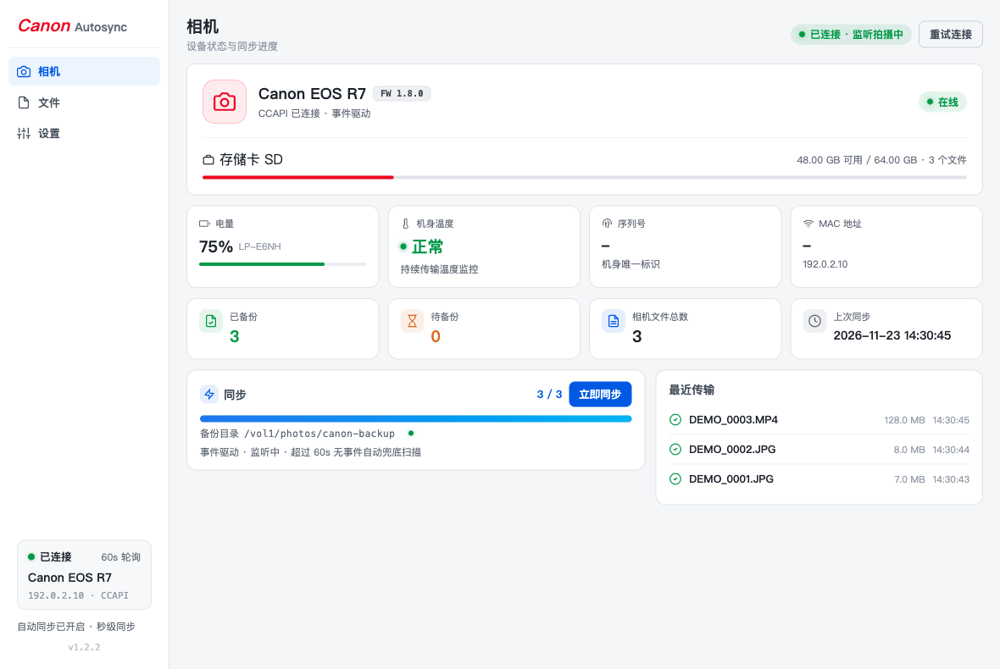

# Canon AutoSync · Automatic Canon camera backups to NAS over Wi-Fi

[](https://hits.sh/github.com/xiaokaiwangcc/canon-autosync/)

[简体中文](README.md) | English

Canon AutoSync uses Canon Camera Control API (CCAPI) to back up new photos and videos over Wi-Fi to a NAS or a local folder, preserving the camera's directory structure. Run it as a fnOS app, in Docker, or as a Windows or macOS desktop app.

## Download and install

| Platform | Get started |
| --- | --- |
| fnOS NAS | [Download FPK](https://github.com/xiaokaiwangcc/canon-autosync/releases/latest/download/canon-autosync.fpk) · [fnOS setup and first backup (Chinese)](docs/fnos-quickstart.md) |
| Docker | [Deploy with Docker Compose](#docker) |
| Windows | [Download EXE](https://github.com/xiaokaiwangcc/canon-autosync/releases/latest/download/canon-autosync-windows.exe) |
| macOS | [Download DMG](https://github.com/xiaokaiwangcc/canon-autosync/releases/latest/download/canon-autosync-macos.dmg) · [Download ZIP](https://github.com/xiaokaiwangcc/canon-autosync/releases/latest/download/canon-autosync-macos.zip) |
| From source | [Run locally](#run-locally) |

[All releases and downloads](https://github.com/xiaokaiwangcc/canon-autosync/releases) · [Changelog (Chinese)](CHANGELOG.md)

## First backup

1. **Enable CCAPI on the camera.** Check that your camera and firmware support CCAPI. If your model requires activation, use Canon's Windows activation tool over USB for the one-time setup. On the camera, choose **Wi-Fi settings → Camera Control API → Connect** and join the local network. From the device running Canon AutoSync, open the address shown on the camera, such as `http://<camera-ip>:8080/ccapi`, and check that it returns JSON. [Canon Camera API Package](https://asia.canon/en/campaign/developerresources/camera/cap)
2. **Set the backup folder.** In **Settings**, enter the IP address and port shown on the camera and choose a folder the app can write to. For Docker, use a path mounted inside the container.
3. **Take a test photo.** Check that the camera is connected, take a photo, and look for it under **Files → Backed up** and in your backup folder. The app listens for new captures when camera events are available and falls back to scheduled scans with a default interval of 60 seconds. Select **Sync now** to check the connection and file transfer manually.

## Camera compatibility

Canon AutoSync detects the CCAPI resources exposed by the camera and selects its listing, event and status endpoints accordingly. Features vary by camera and firmware. Pagination for large directories on older firmware that only returns plain listings still needs camera testing. [CCAPI compatibility and validation (Chinese)](docs/ccapi-compatibility.md)

The project has a historical test record for the Canon EOS R7 with firmware 1.8.0. The Canon AutoSync v1.0.8 dashboard showed 77 backed-up files, with both JPG photos and MP4 videos in the transfer history. [EOS R7 test record (Chinese)](docs/ccapi-compatibility.md#实机兼容记录)

## Features

- **Automatic sync** listens for new captures and falls back to scheduled scans when camera events are unavailable. The default scan interval is 60 seconds.
- **Transfer safeguards** pause sync if the camera overheats or its battery is empty, flag slow Wi-Fi transfers, and limit and cache thumbnail requests to reduce load on the camera.
- **Camera dashboard** shows battery level, temperature, card capacity, serial number, MAC address, and sync progress.
- **File browser** shows backed-up and pending files in grid or list view, with pagination and filename search across the backup library. It previews full-size images and videos, plus thumbnails for RAW files with embedded JPEG previews and for MP4 and MOV videos. Use the arrow keys to browse previews and Esc to close them.
- **Backup management** lets you delete NAS backups and exclude the corresponding camera originals from automatic backup. Use **Restore backup** to include a file again. You can also enable automatic deletion of originals after backup.

Use **Settings → About → Interface language** to switch between English and Simplified Chinese. The web app remembers your choice in the current browser. On first use it selects Simplified Chinese for a Chinese browser locale and English otherwise.



*The interface example uses simulated data.*

## Run locally

The backend uses Python and FastAPI, and the frontend uses React and Vite.

From the repository root, start the backend in one terminal.

```bash
cd backend
python3 -m venv .venv
source .venv/bin/activate
pip install -r requirements.txt
uvicorn app.main:app --port 8000
```

From the repository root, start the frontend in a second terminal.

```bash
cd frontend
npm ci
npm run dev
```

Open [the local app](http://localhost:5173) and set the **Camera IP**, **Port**, and **NAS backup folder** under **Settings**. You can also set `CANON_IP` and `NAS_PATH` in the backend's environment. Configuration and sync state live in `backend/data/` by default.

## Desktop app for macOS and Windows

Download a build from [GitHub Releases](https://github.com/xiaokaiwangcc/canon-autosync/releases). The desktop app launches FastAPI on an available loopback port and opens the same interface in a native window.

To run the desktop app from source, use the following commands from the repository root.

```bash
(cd frontend && npm ci && npm run build)
pip install -r backend/requirements.txt -r desktop/requirements.txt
python desktop/entry.py
```

To build the installer or executable locally, run the following commands after building the frontend.

```bash
python desktop/make_icons.py
pyinstaller desktop/CanonAutoSync.spec --noconfirm
```

Builds are written to `dist/CanonAutoSync.app` on macOS or `dist/CanonAutoSync.exe` on Windows. The Windows build uses WebView2.

The desktop app defaults to `~/Pictures/canon-backup` for backups. It stores configuration and sync state in these directories.

- macOS uses `~/Library/Application Support/canon-autosync/`.
- Windows uses `%APPDATA%\canon-autosync\`.

If macOS blocks the unsigned app when you first open it, look for **Open Anyway** under **System Settings → Privacy & Security**.

## Docker

```bash
docker compose up -d --build
```

Open port `8315` on the NAS or server and sign in as `canon`. On first startup the app saves a generated password to `DATA_DIR/api-password` (by default `./data/api-password` on the host). For access across untrusted networks, serve the app through an HTTPS reverse proxy. Set the following values in a `.env` file to customize the deployment.

```dotenv
CANON_IP=192.168.1.50
BACKUP_DIR=/vol1/photos/canon-backup
DATA_DIR=./data
# CANON_API_PASSWORD=...   # Optional custom login password
```

`CANON_IP` and `BACKUP_DIR` provide the initial camera address and backup folder. On restart, the app uses settings saved in `DATA_DIR/config.json`. `DATA_DIR` holds configuration and sync history, and `BACKUP_DIR` binds the host media folder to the same path in the container. In Settings, choose a path on a mounted volume, such as `BACKUP_DIR` or one of its subdirectories. If you change the host mount, update the Compose configuration and the backup folder in the app.

## fnOS package

Run `./fpk/build.sh` with `fnpack` available to build the frontend and package the app. Upload `fpk/canon-autosync/canon-autosync.fpk` through **App Center → Manual Install**.

- The package uses the fnOS Python 3.12 runtime and installs its Python dependencies from PyPI on first start.
- Enter the camera IP and backup folder in the fnOS installer, which is in Simplified Chinese. Grant the app read and write access to the backup folder in fnOS app settings.
- The app serves its bilingual interface on port `8315`. Configuration, sync state, and `app.log` live in the fnOS package data directory (`TRIM_PKGVAR`).
- Sign in as `canon` using the generated password in `TRIM_PKGVAR/api-password`. If the app window does not show a login prompt, open `http://<NAS IP>:8315` directly in a browser.

## API

| Method | Path | Purpose |
| --- | --- | --- |
| GET | `/api/status` | Camera status, sync progress, and counts |
| GET / POST | `/api/config` | Read or save configuration |
| POST | `/api/sync` | Start a sync |
| POST | `/api/sync/stop` | Request a stop for the current sync |
| POST | `/api/reconnect` | Retry the camera connection |
| GET | `/api/files` | Search backup filenames with `q` and paginate with `cursor` or `offset` plus `limit` |
| DELETE | `/api/files?path=` | Delete a backup record and its file on the NAS |
| POST | `/api/files/restore?path=` | Include an ignored camera original in automatic backups again |
| GET | `/api/pending` | List camera files that are pending backup |
| GET | `/api/thumb?path=` | Fetch a camera thumbnail |
| GET | `/api/preview?id=&size=` | Preview a recorded backup using the `id` returned by `/api/files` |

## Tests and license

- Automated tests cover backup and configuration behavior. CI runs backend tests on Linux, macOS, and Windows. [.github/workflows/test.yml](.github/workflows/test.yml)
- The project source code is licensed under MIT. [LICENSE](LICENSE) · [Third-party notices](THIRD_PARTY_NOTICES.md)
- The CCAPI client implementation draws on [laszewsk/canon-r7-ccapi](https://github.com/laszewsk/canon-r7-ccapi).
