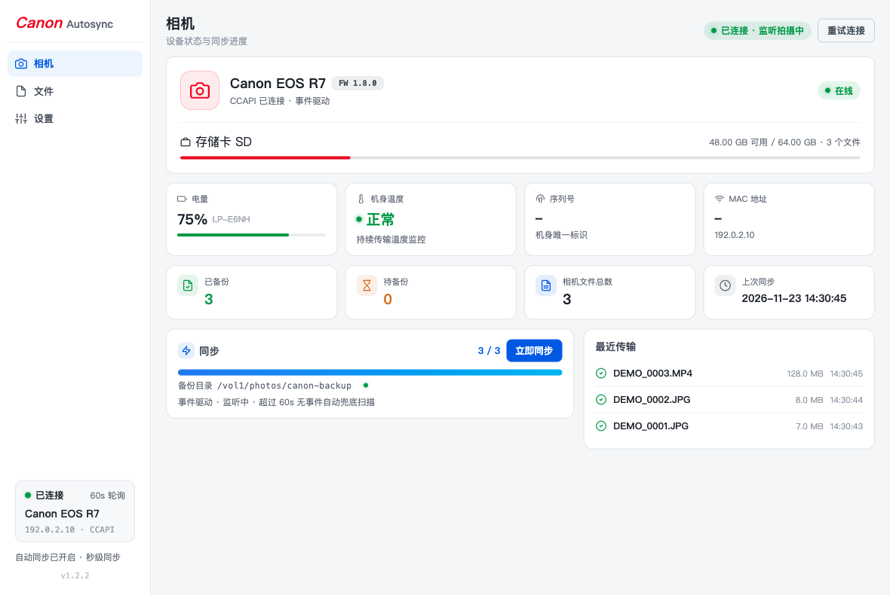

# Canon AutoSync · 佳能相机 Wi-Fi 自动备份到 NAS

[](https://hits.sh/github.com/xiaokaiwangcc/canon-autosync/)

简体中文 | [English](README.en.md)

Canon AutoSync 通过佳能 Camera Control API（CCAPI），经 Wi-Fi 将相机里的照片和视频自动增量备份到 NAS 或电脑本地目录，保留相机的目录结构。可在飞牛 NAS（fnOS）、Docker、Windows 和 macOS 上运行。

## 下载与安装

| 平台 | 安装入口 |
| --- | --- |
| 飞牛 NAS（fnOS） | [下载 FPK](https://github.com/xiaokaiwangcc/canon-autosync/releases/latest/download/canon-autosync.fpk) · [飞牛 NAS 安装与首次备份教程](docs/fnos-quickstart.md) |
| Docker | [Docker Compose 部署](#docker-部署) |
| Windows | [下载 EXE](https://github.com/xiaokaiwangcc/canon-autosync/releases/latest/download/canon-autosync-windows.exe) |
| macOS | [下载 DMG](https://github.com/xiaokaiwangcc/canon-autosync/releases/latest/download/canon-autosync-macos.dmg) · [下载 ZIP](https://github.com/xiaokaiwangcc/canon-autosync/releases/latest/download/canon-autosync-macos.zip) |
| 从源码运行 | [本地开发](#本地开发) |

[所有版本与安装包](https://github.com/xiaokaiwangcc/canon-autosync/releases) · [版本变更与 Bug 修复](CHANGELOG.md)

## 首次备份

1. **启用 CCAPI。** 相机需要支持 CCAPI 的机型和固件。若机型要求激活，先用佳能提供的 Windows 激活工具通过 USB 完成一次性设置。然后在相机的 Wi-Fi 设置中选择 **Camera Control API → 连接**，接入局域网。在运行 Canon AutoSync 的设备上打开相机显示的地址，例如 `http://<相机IP>:8080/ccapi`，确认能看到 JSON。 [佳能中国 SDK 获取入口](https://www.canon.com.cn/supports/sdk/icp/)
2. **设置备份目录。** 在 Canon AutoSync 的「设置」中填写相机显示的 IP 和端口，选择应用有写入权限的备份目录。Docker 部署请选容器内已挂载的目录。
3. **拍一张测试照片。** 确认「相机」页显示已连接，拍摄一张照片后在「文件 → 已备份」中查找，并在目标目录确认文件已写入。事件接口可用时会自动触发同步，定时扫描默认间隔 60 秒。也可以点击「立即同步」验证连接和写入。

## 机型兼容性

程序会根据相机提供的 CCAPI 资源选择目录、事件和状态接口。可用功能随相机型号和固件而变化，部分只提供普通目录响应的旧接口，其大目录翻页仍待实机验证。 [CCAPI 适配范围与验证方法](docs/ccapi-compatibility.md)

仓库已有 Canon EOS R7（固件 1.8.0）的历史实机记录。Canon AutoSync v1.0.8 的界面显示 77 个文件已备份，最近传输中包含 JPG 和 MP4。 [EOS R7 实机记录](docs/ccapi-compatibility.md#实机兼容记录)

## 功能特性

- 在「设置 → 关于 → 界面语言」切换中英文界面，网页会记住当前浏览器中的选择。
- 自动监听新拍摄的照片和视频。事件接口不可用时按设定间隔扫描。
- 按相机公布的 CCAPI 资源选择接口，目录读取支持 `ver100`–`ver140` 候选和普通、chunked 响应。
- 相机过热或电量耗尽时暂停同步。传输减速时提示用户，并限制和缓存缩略图请求以减少相机负载。
- 相机面板显示电量、温度、存储卡容量、序列号、MAC 地址和同步进度。
- 文件列表会自动刷新。已备份文件支持分页、全库文件名搜索和预览。文件页可切换列表和图标视图，显示带内嵌 JPEG 的 RAW 文件缩略图以及 MP4、MOV 的首帧。
- 删除备份后，对应的相机原件会进入忽略名单。解除忽略后，相机上仍存在的原件可再次备份。也可在设置中启用同步后删除卡上文件。



*界面示例使用模拟数据。*

## 原理

相机通过 Wi-Fi 开启 CCAPI 后，后端循环处理以下步骤。

1. 检查温度和电量，读取存储卡目录，与本地同步记录对比，筛出待备份文件。
2. 增量下载到目标目录，保留相机目录结构并记录已完成的文件。
3. 队列处理完后等待新拍摄事件。相机不支持事件接口或等待超时时，按配置的间隔扫描。

## 本地开发

后端使用 Python 和 FastAPI，前端使用 React 和 Vite。在两个终端中从仓库根目录分别启动后端和前端。

```bash
# 后端
cd backend
python3 -m venv .venv && source .venv/bin/activate
pip install -r requirements.txt
uvicorn app.main:app --port 8000
```

```bash
# 前端
cd frontend
npm ci
npm run dev
```

打开 http://localhost:5173 ，在"设置"里填相机 IP（默认 192.168.5.53:8080）和备份目录。默认值也可用环境变量覆盖：

```bash
export CANON_IP=192.168.1.50        # 相机 IP
export NAS_PATH=/Volumes/photos/canon-backup   # 备份目录
```

配置和同步状态存于 `backend/data/`。

## 桌面应用（macOS / Windows）

基于 pywebview + PyInstaller：本地启动 FastAPI（动态空闲端口，仅监听 127.0.0.1），原生窗口加载前端，代码与后端完全复用。

```bash
(cd frontend && npm ci && npm run build)
pip install -r backend/requirements.txt -r desktop/requirements.txt
python desktop/entry.py        # 弹出桌面窗口
```

打包：

```bash
python desktop/make_icons.py   # 生成 icon.ico / icon.icns
pyinstaller desktop/CanonAutoSync.spec --noconfirm
```

产物：macOS `dist/CanonAutoSync.app`、Windows `dist/CanonAutoSync.exe`（单文件，Win10/11 自带 WebView2 Runtime）。打 `v*` tag 触发 GitHub Actions 双平台自动构建并附带至 Release。

数据目录（首次启动自动创建，备份目录默认 `~/Pictures/canon-backup`，可在界面设置中修改）：

- macOS：`~/Library/Application Support/canon-autosync/`
- Windows：`%APPDATA%\canon-autosync\`

macOS 首次打开提示"无法验证开发者"（应用未签名公证），任选其一绕过：

- 右键应用 →「打开」→ 弹窗点「打开」
- 系统设置 → 隐私与安全性 →「仍要打开」
- 命令行：`xattr -d com.apple.quarantine /Applications/CanonAutoSync.app`

## Docker 部署

适用于任何支持 Docker 的 NAS / 服务器（不限于飞牛）：

```bash
docker compose up -d --build   # 默认相机 IP 192.168.5.53、备份目录 /vol1/photos/canon-backup
```

打开 `http://<NAS IP>:8315`，使用用户名 `canon` 登录。首次启动会把随机密码保存到 `DATA_DIR/api-password`（默认 `./data/api-password`），可在宿主机读取。可用 `.env` 设置初始值和挂载目录：

```bash
CANON_IP=192.168.1.50                # 初始相机 IP
BACKUP_DIR=/vol1/photos/canon-backup # 照片挂载目录（宿主路径），也是初始备份目录
DATA_DIR=./data                      # 配置与同步记录存储位置
# CANON_API_PASSWORD=...            # 可选，自定义登录密码
```

重启时优先读取 `DATA_DIR/config.json` 中通过网页保存的相机 IP 和备份目录。网页里的备份目录应指向容器已挂载的路径，例如默认 Compose 中的 `BACKUP_DIR` 或其子目录。更换宿主机挂载目录时，请同步更新 Compose 配置和网页里的备份目录。

部署要点：

- **host 网络模式**：相机经 Wi-Fi 接入宿主机网络（如 NAS 发射的 AP 热点），容器需共享宿主机网络栈才能直连相机 IP，故 `docker-compose.yml` 使用 `network_mode: host`，端口固定 8315
- **数据持久化**：配置/同步记录存于 `DATA_DIR` 卷、照片存于 `BACKUP_DIR` 卷，升级不丢失
- **访问控制**：NAS 版使用 HTTP Basic 登录。跨不可信网络访问时，通过 HTTPS 反向代理提供服务。
- 多阶段构建：Node构建前端 → Python 3.12 单容器托管（单端口 8315）

## 打包飞牛 fnOS 应用（.fpk）

```bash
./fpk/build.sh   # 构建前端 + 组装 + fnpack build
```

产物 `fpk/canon-autosync/canon-autosync.fpk`，在飞牛应用中心 → 手动安装 上传即可。

打包机制：

- 前端构建为静态文件，由 FastAPI 在 8315 端口直接托管（单端口）
- 依赖飞牛官方 Python 运行时（`install_dep_apps=python312`），首次启动自动创建 venv 并 pip install（需 NAS 能访问 PyPI）
- 安装向导询问相机 IP 和备份目录；使用自定义目录需在 应用设置 → 授权目录中授权
- 配置和同步记录存于应用数据目录（`TRIM_PKGVAR`），升级不丢失；日志在 `app.log`
- 首次启动会在应用数据目录生成 `api-password`。使用用户名 `canon` 和该文件中的密码登录；如果应用窗口未弹出登录框，直接在浏览器打开 `http://<NAS IP>:8315`。

## API

| 方法 | 路径 | 说明 |
|---|---|---|
| GET | /api/status | 相机状态、同步进度、统计 |
| GET/POST | /api/config | 读取/保存配置 |
| POST | /api/sync | 手动触发同步 |
| POST | /api/sync/stop | 停止当前同步 |
| POST | /api/reconnect | 重试连接相机 |
| GET | /api/files | 已备份文件列表，支持 `q` 文件名搜索、`cursor` 游标和 `offset`、`limit` 分页参数 |
| DELETE | /api/files?path= | 删除已备份记录及其 NAS 上的文件 |
| POST | /api/files/restore?path= | 移出忽略名单，恢复自动备份 |
| GET | /api/pending | 相机上待备份文件 |
| GET | /api/thumb?path= | 相机文件缩略图（并发限制 + 缓存） |
| GET | /api/preview?id=&size= | 预览已登记的备份，使用 `/api/files` 返回的 `id` |

## 测试与许可

- 自动化测试覆盖备份与配置行为，持续集成在 Linux、macOS 和 Windows 上运行后端测试。 [.github/workflows/test.yml](.github/workflows/test.yml)
- 项目源代码采用 MIT 许可证。 [LICENSE](LICENSE) · [第三方声明](THIRD_PARTY_NOTICES.md)
- CCAPI 客户端实现参考了 [laszewsk/canon-r7-ccapi](https://github.com/laszewsk/canon-r7-ccapi)。
