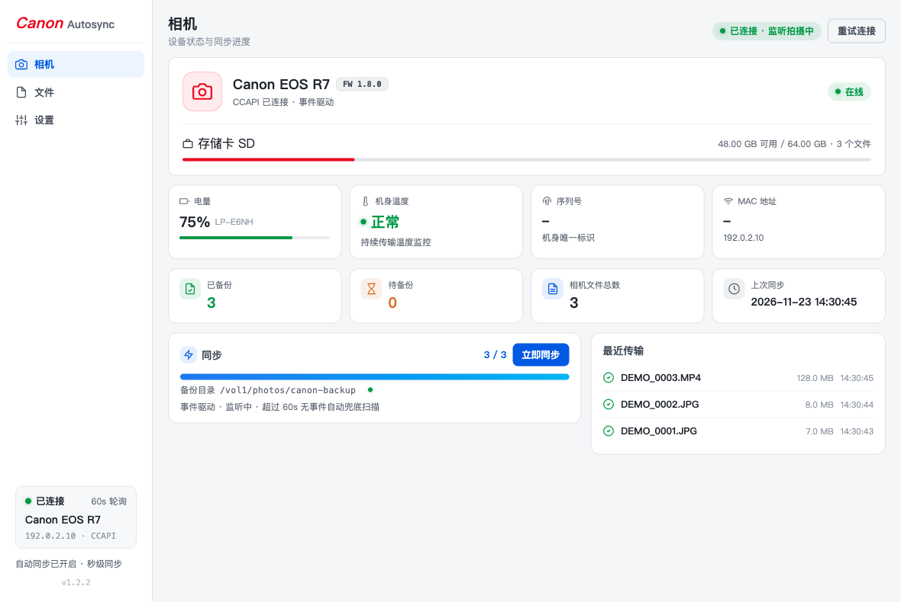

# 把佳能相机的照片和视频自动备份到飞牛 fnOS

Canon AutoSync 从相机的 Camera Control API（CCAPI）读取照片和视频，按相机目录结构备份到 NAS。教程使用 v1.2.2 的 fnOS 安装包。该版本在 fnOS 上的实机结果待补充，可以先参考已有的 EOS R7 历史记录。 [下载 v1.2.2 FPK](https://github.com/xiaokaiwangcc/canon-autosync/releases/download/v1.2.2/canon-autosync.fpk) · [EOS R7 实测记录](ccapi-compatibility.md#实机兼容记录)

## 1. 确认 NAS 能访问相机的 CCAPI

1. 对照佳能的 CCAPI 版本和机型资料确认相机及固件支持。若相机菜单里还没有「Camera Control API」，按佳能提供的说明获取对应的激活工具。需要 Windows 工具的机型通常通过 USB 连接电脑完成一次激活。 [佳能中国 SDK 与 CCAPI 资料](https://www.canon.com.cn/supports/sdk/icp/)
2. 在相机的网络设置中选择 **Camera Control API** 连接方式，让相机接入 NAS 可访问的网络。多数家庭可把相机接入主 Wi-Fi，让 NAS 接同一路由器的网线。访客 Wi-Fi、设备隔离或跨子网防火墙可能挡住 NAS 到相机的连接。
3. 记下相机画面上显示的 CCAPI 地址，例如 `http://192.168.1.50:8080/ccapi`。在同一局域网的电脑浏览器打开实际地址，确认能看到 JSON。有 NAS 管理终端权限的话，再从 NAS 测一次，把示例地址换成相机显示的地址。

```sh
curl -fsS --max-time 10 'http://192.168.1.50:8080/ccapi'
```

手机连接和 EOS Utility 遥控各有独立的连接模式。备份时在相机上选用 **Camera Control API**，并让相机保持开机。

## 2. 安装 FPK 并授权备份目录

1. 用管理员账号打开飞牛 **文件管理**，创建用于备份的文件夹。右键该文件夹，选择 **详细信息 → 复制原始路径**，得到以 `/` 开头的 NAS 路径。
2. 打开飞牛 **应用中心 → 手动安装**，上传 [v1.2.2 的 canon-autosync.fpk](https://github.com/xiaokaiwangcc/canon-autosync/releases/download/v1.2.2/canon-autosync.fpk)。在「备份设置」向导中填写相机 IP 和上一步复制的目录。安装向导写入默认相机端口 `8080`，相机使用其他端口时可在登录后调整。
3. 在飞牛 **设置 → 应用设置 → 佳能备份** 中打开 **访问权限** 或 **授权目录**，添加刚才的备份目录并授予读写权限。首次启动会使用飞牛的 Python 3.12 运行时安装依赖，请让 NAS 能访问 Python 包源。 [安装向导](../fpk/canon-autosync/wizard/install) · [依赖安装脚本](../fpk/canon-autosync/cmd/setup_env)

## 3. 登录「佳能备份」

在飞牛桌面打开「佳能备份」。如果内嵌窗口没有出现登录框，在局域网浏览器直接打开 `http://<NAS 的局域网 IP>:8315`。浏览器登录用户名为 `canon`，首次成功启动生成的密码保存在运行时数据目录的 `api-password` 文件中。

请由 NAS 管理员在 NAS 的终端读取密码。飞牛提供 `/var/apps/<应用包名>/var` 作为运行时数据目录的入口，指向安装时选定的实际数据卷。此应用包名为 `canon-autosync`。 [飞牛应用目录说明](https://developer.fnnas.com/docs/core-concepts/framework/) · [应用启动脚本](../fpk/canon-autosync/cmd/main) · [密码生成规则](../backend/app/access.py)

```sh
sudo readlink -e /var/apps/canon-autosync/var
sudo cat /var/apps/canon-autosync/var/api-password
```

配置 `config.json`、同步记录 `state.json` 和日志 `app.log` 也在这个目录。登录后打开 **设置**，检查相机 IP、端口及 NAS 备份目录。首次验证请保持「同步后清理卡上文件」关闭。

## 4. 验证第一张照片和第一段视频

1. 建议用一张只存放测试素材的卡。让相机保持 CCAPI 连接，在「相机」页确认已连接，拍一张 JPG，再录一小段 MP4，结束录制并等待相机写完卡。
2. 保持「自动同步」打开，等待事件触发或下一轮定时扫描。也可以点击 **立即同步** 检查手动传输。如果拍摄需要先断开相机连接，拍完再连回 CCAPI，并把本次结果记为重新连接后的扫描结果。
3. 打开 **文件 → 已备份**，搜索两份样片的文件名。在飞牛文件管理进入授权目录，确认原文件实际存在，照片能打开，视频能播放。应用会保留 CCAPI 返回的存储和子目录层级。例如，相机返回 `/ccapi/ver130/contents/sd/DCIM/100CANON/IMG_0001.JPG`，文件会写到备份目录下的 `sd/DCIM/100CANON/IMG_0001.JPG`。以相机的实际目录为准。
4. 再点一次 **立即同步**。检查同一张卡上的两份样片没有产生重复副本，然后查看它们仍可从相机回放。



上图为使用模拟数据的应用界面。

## 常见卡点

| 现象 | 检查 |
| --- | --- |
| 相机上找不到 Camera Control API | 核对机型、固件及激活状态，然后按佳能提供的说明设置连接。 |
| 相机未连接，或者一直提示超时 | 核对相机还在 CCAPI 模式且地址未变化，从 NAS 检查 `/ccapi` 是否返回 JSON。若电脑可访问而 NAS 超时，检查访客 Wi-Fi、设备隔离和 NAS 到相机的路由。 |
| 打不开应用，或缺少 `api-password` | 在应用中心确认已启动、Python 3.12 依赖已安装。管理员可运行 `sudo tail -n 60 /var/apps/canon-autosync/var/app.log`，查看启动或下载依赖的报错。 |
| 显示已连接，备份报错或目录没写入文件 | 在飞牛应用设置中检查目标目录已有读写授权，在应用「设置」核对原始路径，并确认目标存储空间可用。 |
| 拍摄后要等一会儿才开始传 | 查看应用顶部是事件监听还是「定时扫描」。后者要等到配置的扫描间隔，也可点「立即同步」排查。 |

## 提交机型实测

欢迎记录机型、固件、fnOS 版本、应用版本和测试日期，并逐项填写 JPG、MP4、RAW、事件触发、定时扫描、断线重连中的实测结果。标明当时使用自动还是手动同步，以及在 NAS 上验证了哪些文件。 [提交兼容性报告](https://github.com/xiaokaiwangcc/canon-autosync/issues/new?template=camera-compatibility.yml)

同一浏览器登录应用后，可打开 `http://<NAS 的局域网 IP>:8315/api/status`。报告只需摘录 `ccapi` 中的 `versions`、`endpoints`（相对路径）、`contents_list_mode` 和 `unsupported`。截图、日志片段及路径示例要遮挡密码、相机及 NAS IP、SSID、序列号、MAC、用户名和私人文件路径。用描述或脱敏证据说明落盘结果即可。 [兼容性说明](ccapi-compatibility.md)

[返回 Canon AutoSync 项目首页](https://github.com/xiaokaiwangcc/canon-autosync)
